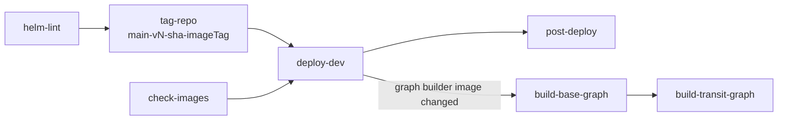
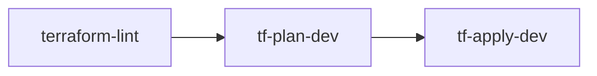
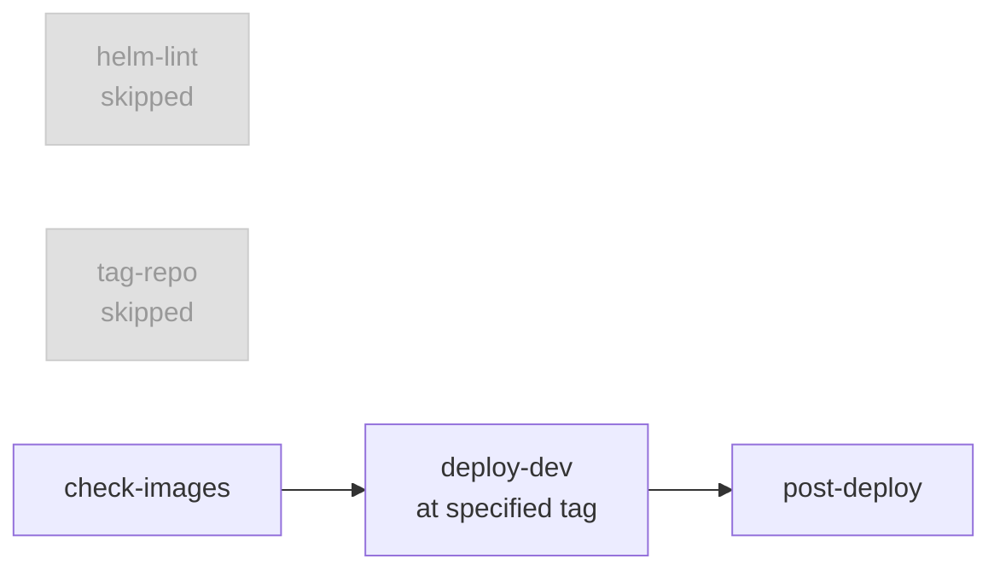

# otp2int-deployment-config

Helm deployment configuration for the **otp2int** (OpenTripPlanner International) instance at Entur.

## Overview

`otp2int` is a separate OTP2 instance covering Norway Sweden, Denmark, and Finland . It runs alongside the Norwegian `otp2` instance in the same Kubernetes cluster but as an independent deployment with its own graph data, buckets, and GCP project.

## Structure

```text
helm/otp2int/
├── Chart.yaml
├── values.yaml                          # Default values, including the two images
├── env/
│   ├── logback.xml
│   └── values-kub-ent-jp-dev.yaml       # Dev environment overrides
├── files/
│   └── merge_netex.py                   # Merges the Norway and Sweden NeTEx datasets
└── templates/
    ├── deployment.yaml                  # OTP2int journey planner
    ├── service.yaml
    ├── ingress.yaml
    ├── horizontalpodautoscaler.yaml
    ├── configmap.yaml                   # router-config.json
    ├── otp2-feature-configmap.yaml      # otp-config.json feature flags
    ├── otp2int-build-configmap.yaml     # build-config.json with the graph path
    ├── logback-configmap.yaml           # Used by the journey planner and the graph builders
    ├── configmap-graph-builder.yaml     # Graph builder build/otp config
    ├── configmap-merge-netex.yaml       # merge_netex.py for the transit graph build
    ├── cronjob-base-graph-builder.yaml  # Street graph job template (suspend=true)
    └── cronjob-graph-builder.yaml       # Street+transit graph job template (suspend=true)
```

## Components

### Journey Planner
Serves the OTP2 GraphQL/REST API.
Loads the graph from GCS on startup.

OTP fills in the serialization version id, for example `EN-0242`.
The serialization version id changes only when the graph format changes.
- **Same id:** a new graph build overwrites the existing graph file. A new OTP image with the same id also reads this file.
- **New id:** the graph builder writes to a new directory. Graphs for older ids stay in their own directories.

> [!IMPORTANT]
> When you upgrade to an OTP image with a new serialization version id, no graph exists for that id yet.
> The pods crash-loop, and Helm rolls back the deploy.
> Thus build the graphs with the new image before the journey planner gets it.
> See [Updating the OTP image](#updating-the-otp-image).

#### Updating the OTP image
The chart has two image values:
- `cronjobGraphBuilder.image` is the image of the graph builder CronJobs.
- `image.identifier` is the image of the journey planner pods.

Update the image in two commits:
1. Set `cronjobGraphBuilder.image` to the new image, and merge.
   The deploy updates the CronJobs, and then builds the base graph and the transit graph with the new image.
   The journey planner pods keep the old image.
1. When the graph build succeeds, set `image.identifier` to the same image, and merge.
   The journey planner pods get the new image and load the new graph.

After a successful transit graph build, `run-graph-builder.yml` writes the image to the annotation `entur.io/graph-built-with-image` on the CronJob `graph-builder-otp2int`.
The deploy stops with an error if `image.identifier` changes to an image that is not in this annotation.
This prevents the crash loop if you merge the second commit too early, or put both changes in one commit.

Until the second commit, the scheduled graph builds use the new image.
If the serialization version id changed, the journey planner does not get fresh graphs in this period.
Thus merge the second commit soon after the graph build succeeds.

#### Rolling back to a previous graph
Each build overwrites the graph file for its serialization version id.
To go back to an older graph with the same id, run the graph builder again with the older input data.

A rollback to an image with an older serialization version id loads the graph that is still in that id's directory.

### Graph Builder
Two suspended CronJobs are job templates.
The workflows create jobs from them.
- `graph-builder-otp2int-base` builds the street graph.
- `graph-builder-otp2int` loads the street graph, adds the transit data and builds the graph that the journey planner loads.

The graph is built dailty using scheduled workflows.
After the scheduled transit graph build, the journey planner pods restart to load the new graph.
The deploy also builds both graphs when `cronjobGraphBuilder.image` changes.
Only one graph build runs at a time.

The graphs are built from:
- **Sweden** — NeTEx 
- **Norway** — NeTEx 
OSM data is pulled from Geofabrik for Norway and Sweden.
Elevation data comes from the Kartverket height data (`dem` in `configmap-graph-builder.yaml`).
The graph builder uses no real-time updates.

#### Adding new sources
1. Update `helm/otp2int/templates/configmap-graph-builder.yaml`
   1. `transitFeeds`, see the other sources for examples
   2. `osm`, see the other sources for examples
2. Ensure otp2int pipeline has access to the new sources

## CI/CD Workflows

| Workflow | Trigger | Purpose |
|---|---|---|
| `deploy.yml` | Push to `main` (except `terraform/**` and `*.md`), manual | Helm lint, tag repo, check images, deploy to dev, build graphs when the graph builder image changed |
| `terraform.yml` | PR and push with `terraform/**` changes, manual | Terraform lint, plan and apply |
| `build.yml` | PR | Helm lint |
| `pr.yml` | PR | Verify PR title and body |
| `codeql.yml` | PR, push to `main`, weekly | CodeQL security scan |
| `terraform-drift-detection.yml` | Weekly, manual | Plan dev and open an issue on drift |
| `run-graph-builder.yml` | Manual, called by `deploy.yml` and the scheduled builds | Create a graph builder job, wait for it, and restart the journey planner after a transit graph build |
| `scheduled-base-graph-build.yml` | Daily at 00:00 UTC | Build the base (street) graph |
| `scheduled-graph-build.yml` | Daily at 08:00 UTC | Build the transit graph and restart the journey planner |

### Normal Deploy (push to main / workflow_dispatch without tag)



- `check-images` stops the deploy if the journey planner image changes before graphs exist for it.
  See [Updating the OTP image](#updating-the-otp-image).
- `build-base-graph` and `build-transit-graph` run only when `cronjobGraphBuilder.image` changed.
  They do not restart the journey planner.
- Only one deploy runs at a time.
  A newer queued deploy replaces an older queued deploy.

### Terraform changes

Terraform runs in `terraform.yml`, separate from the Helm deploy.



> On a PR with `terraform/**` changes, only lint and plan run, and the plan shows on the PR. After merge to `main`, dev is applied automatically. `tf-apply-dev` is skipped when `tf-plan-dev` detects no changes.

> [!IMPORTANT]
> `deploy.yml` does not wait for `terraform.yml`. If a Helm change needs new infrastructure, merge the Terraform change in its own PR first. Merge the Helm change after `tf-apply-dev` is done.

### Manually deploy from branch
The graph builder uses what ever is *currently* deployed, so to deploy from a branch you need to first deploy the branch, then do the graph build.
Main is automatically deployed when merged to the `main` branch, but remember to deploy from main after you are done testing on a branch if you dont merge straight away.

1. Manually run deploy on branch
2. Manually run graph-build on branch
3. Do your testing/verification
4. Manually run deploy on main or merge branch to main

### Rollback (workflow_dispatch with tag input)



> `helm-lint` and `tag-repo` are always skipped on rollback. Helm deploys the config and image from the specified tag. Rollback does not change infrastructure. To roll back Terraform, run `terraform.yml` manually and select the tag as the ref.

A rollback to an older journey planner image stops at `check-images`, because the last graph build used the newer image.
If graphs for the older serialization version id still exist, set `skip_graph_check` to `true` in the workflow input.
If the tag also has an older `cronjobGraphBuilder.image`, the deploy then builds the graphs again with the older image.

### Deploying / Rolling Back

| Action | How |
|---|---|
| Normal deploy | Push to `main` or trigger workflow without tag |
| Update the OTP image | Two commits, see [Updating the OTP image](#updating-the-otp-image) |
| Roll back | Trigger workflow → enter tag e.g. `main-v19-ccde0368-v2.10.0-entur-32`. Set `skip_graph_check` for an older journey planner image |
| Find available tags | `git tag -l` or GitHub → Code → Tags |

## Deviations from the Golden Path

This repository differs from the [Entur Golden Path](https://github.com/entur/ai/blob/main/skills/setup-cicd-workflows/SKILL.md) for CI/CD. The table gives the reason for each difference.

| Deviation | Golden Path | Reason |
|---|---|---|
| `deploy.yml` tags the repository and supports rollback with a tag. | The image tag from the PR build is used for promotion. | No image is built here, so the repository tag identifies the deployed config and image. |
| `terraform.yml` applies dev after merge, not on the PR. | Apply dev on the PR. Apply tst and prd after merge. | Dev is the only environment. Changes are applied only after review and merge. Use the Golden Path flow when tst and prd exist. |
