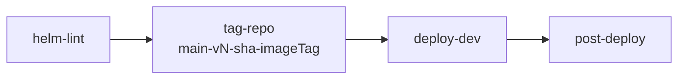
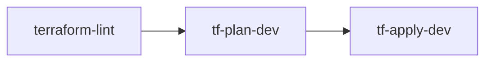
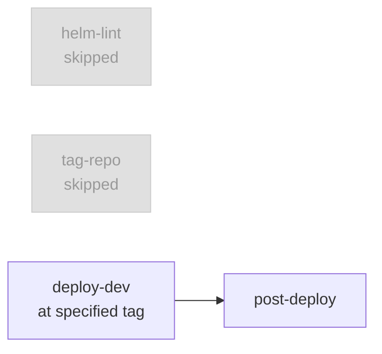

# otp2int-deployment-config

Helm deployment configuration for the **otp2int** (OpenTripPlanner International) instance at Entur.

## Overview

`otp2int` is a separate OTP2 instance covering Norway Sweden, Denmark, and Finland . It runs alongside the Norwegian `otp2` instance in the same Kubernetes cluster but as an independent deployment with its own graph data, buckets, and GCP project.

## Structure

```
helm/otp2int/
├── Chart.yaml
├── values.yaml                        # Default values
├── env/
│   ├── logback.xml
│   └── values-kub-ent-jp-dev.yaml     # Dev environment overrides
└── templates/
    ├── deployment.yaml                # OTP2int journey planner
    ├── service.yaml
    ├── ingress.yaml
    ├── configmap.yaml                 # router-config.json
    ├── otp2-feature-configmap.yaml    # otp-config.json feature flags
    ├── logback-configmap.yaml
    ├── secrets.yaml                   # ExternalSecrets (SLACK_URL, SAMTRAFIKEN_API_KEY)
    ├── rbac.yaml
    ├── horizontaloidautoscaler.yaml
    ├── configmap-graph-builder.yaml   # Graph builder build/otp config
    ├── cronjob-graph-builder.yaml     # Graph builder job template (suspend=true)
    ├── logback-configmap-graph-builder.yaml
    └── cronjob-redeploy-otp2.yaml     # Watches GCS pointer, rolls deployment
```

## Components

### Journey Planner
Serves the OTP2 GraphQL/REST API. Loads graphs from GCS on startup by watching the `current-otp2int` pointer file in the graph bucket.

### Graph Builder
A suspended CronJob used as a job template — triggered manually. Builds graphs from:
- **Sweden** — NeTEx 
- **Norway** — NeTEx 
OSM data is pulled from Geofabrik for Norway and Sweden. No elevation data or real-time updates.

#### Adding new sources
1. Update `helm/otp2int/templates/configmap-graph-builder.yaml`
   1. `transitFeeds`, see the other sources for examples
   2. `osm`, see the other sources for examples
2. Ensure otp2int pipeline has access to the new sources

## CI/CD Workflows

| Workflow | Trigger | Purpose |
|---|---|---|
| `deploy.yml` | Push to `main` (except `terraform/**` and `*.md`), manual | Helm lint, tag repo, deploy to dev |
| `terraform.yml` | PR and push with `terraform/**` changes, manual | Terraform lint, plan and apply |
| `build.yml` | PR | Run CI |
| `pr.yml` | PR | Verify PR title and body |
| `codeql.yml` | PR, push to `main`, weekly | CodeQL security scan |
| `terraform-drift-detection.yml` | Weekly, manual | Plan dev and open an issue on drift |
| `run-graph-builder.yml` | Manual | Create a graph builder job |

### Normal Deploy (push to main / workflow_dispatch without tag)



### Terraform changes

Terraform runs in `terraform.yml`, separate from the Helm deploy.



> On a PR with `terraform/**` changes, only lint and plan run, and the plan shows on the PR. After merge to `main`, dev is applied automatically. `tf-apply-dev` is skipped when `tf-plan-dev` detects no changes.

> [!IMPORTANT]
> `deploy.yml` does not wait for `terraform.yml`. If a Helm change needs new infrastructure, merge the Terraform change in its own PR first. Merge the Helm change after `tf-apply-dev` is done.

### Manually deploy from branch
The graph builder uses what ever is *currently* deployed, so to deploy from a branch you need to first deploy the branch, then do the graph build.
Main is automatically deployed when merged to the `main` branch, but remember to deploy from main after you are done testing on a branch if you dont merge straight away.

1. Manually run deploy on branch
2. Manually run graph-build on branch
3. Do your testing/verification
4. Manually run deploy on main or merge branch to main

### Rollback (workflow_dispatch with tag input)



> `helm-lint` and `tag-repo` are always skipped on rollback. Helm deploys the config and image from the specified tag. Rollback does not change infrastructure. To roll back Terraform, run `terraform.yml` manually and select the tag as the ref.

### Deploying / Rolling Back

| Action | How |
|---|---|
| Normal deploy | Push to `main` or trigger workflow without tag |
| Roll back | Trigger workflow → enter tag e.g. `main-v19-ccde0368-v2.10.0-entur-32` |
| Find available tags | `git tag -l` or GitHub → Code → Tags |

## Deviations from the Golden Path

This repository differs from the [Entur Golden Path](https://github.com/entur/ai/blob/main/skills/setup-cicd-workflows/SKILL.md) for CI/CD. The table gives the reason for each difference.

| Deviation                                                                                           | Golden Path                                                             | Reason                                                                                                                         |
|-----------------------------------------------------------------------------------------------------|-------------------------------------------------------------------------|--------------------------------------------------------------------------------------------------------------------------------|
| `terraform.yml` applies dev after merge, not on the PR.                                             | Apply dev on the PR. Apply tst and prd after merge.                     | Dev is the only environment. Changes are applied only after review and merge. Use the Golden Path flow when tst and prd exist. |
| No `dependabot-pr.yml`.                                                                             | Run CI for Dependabot PRs after approval.                               | CI uses no secrets, so `build.yml` already runs on Dependabot PRs.                                                             |
| No `docker` ecosystem in `dependabot.yml`.                                                          | Update Docker base images weekly.                                       | No Dockerfile exists here. The image is set in `helm/otp2int/values.yaml`.                                                     |
| `deploy.yml` lints, tags, deploys and supports rollback with a tag.                                 | The image tag from the PR build is used for promotion.                  | No image is built here, so the repository tag identifies the deployed config and image.                                        |

