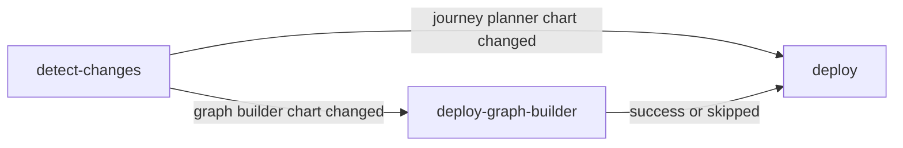
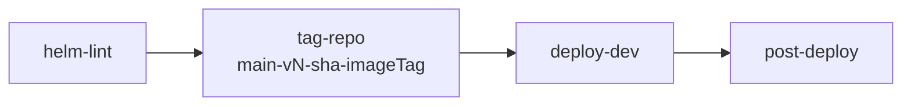
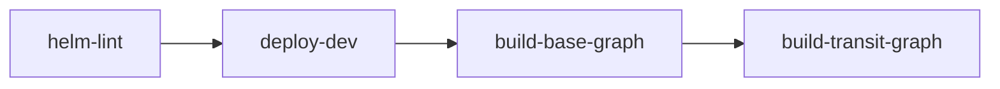
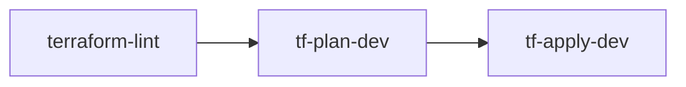
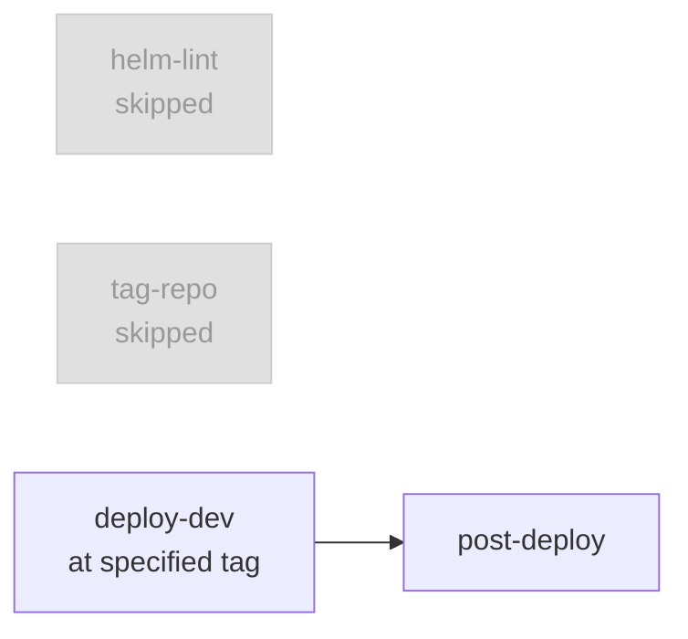

# otp2int-deployment-config

Helm deployment configuration for the **otp2int** (OpenTripPlanner International) instance at Entur.

## Overview

`otp2int` is a separate OTP2 instance covering Norway Sweden, Denmark, and Finland . It runs alongside the Norwegian `otp2` instance in the same Kubernetes cluster but as an independent deployment with its own graph data, buckets, and GCP project.

## Structure

The repository has two Helm charts.
Each chart is a separate Helm release in the `otp2int` namespace, with its own deploy workflow.

```text
helm/otp2int/                            # Release otp2int, deployed by deploy-serving-pods.yml
├── Chart.yaml
├── values.yaml                          # Default values, including the serving image
├── env/
│   ├── logback.xml
│   └── values-kub-ent-jp-dev.yaml       # Dev environment overrides
└── templates/
    ├── deployment.yaml                  # OTP2int journey planner
    ├── service.yaml
    ├── ingress.yaml
    ├── horizontalpodautoscaler.yaml
    ├── configmap.yaml                   # router-config.json
    ├── otp2-feature-configmap.yaml      # otp-config.json feature flags
    ├── otp2int-build-configmap.yaml     # build-config.json with the graph path
    └── logback-configmap.yaml

helm/otp2int-graph-builder/              # Release otp2int-graph-builder, deployed by deploy-graph-builder.yml
├── Chart.yaml
├── values.yaml                          # Default values, including the graph builder image
├── env/
│   ├── logback.xml
│   └── values-kub-ent-jp-dev.yaml       # Dev environment overrides
├── files/
│   └── merge_netex.py                   # Merges the Norway and Sweden NeTEx datasets
└── templates/
    ├── configmap-graph-builder.yaml     # Graph builder build/otp config
    ├── configmap-merge-netex.yaml       # merge_netex.py for the transit graph build
    ├── logback-configmap.yaml
    ├── cronjob-base-graph-builder.yaml  # Street graph job template (suspend=true)
    └── cronjob-graph-builder.yaml       # Street+transit graph job template (suspend=true)
```

The graph builders write the graphs to `environmentValues.otp2intGcpBaseName`, and the journey planner reads them from there.
Keep this value the same in both charts.

## Components

### Journey Planner
Serves the OTP2 GraphQL/REST API.
Loads the graph from GCS on startup.

OTP fills in the serialization version id, for example `EN-0242`.
The serialization version id changes only when the graph format changes.
- **Same id:** a new graph build overwrites the existing graph file. A new OTP image with the same id also reads this file.
- **New id:** the graph builder writes to a new directory. Graphs for older ids stay in their own directories.

> [!IMPORTANT]
> When you upgrade to an OTP image with a new serialization version id, no graph exists for that id yet.
> The pods crash-loop, and Helm rolls back the deploy.
> Thus build the graphs with the new image before the journey planner gets it.
> See [Updating the OTP image](#updating-the-otp-image).

#### Updating the OTP image
Each chart has its own image value, `image.identifier`:
- `helm/otp2int-graph-builder/values.yaml` has the image of the graph builder CronJobs.
- `helm/otp2int/values.yaml` has the image of the journey planner pods.

Set both images to the new image in the same commit.
`image-bump.yml` opens a pull request that does this when a new OTP release exists.
After the merge, `cd.yml` does these steps in this order:
1. Deploys the graph builder release, and builds the base graph and the transit graph with the new image.
1. Deploys the journey planner release. The pods get the new image and load the new graph.

If the graph builder deploy or a graph build fails, the journey planner pods keep the old image.
See [Deploy on push to main](#deploy-on-push-to-main-cdyml).

#### Rolling back to a previous graph
Each build overwrites the graph file for its serialization version id.
To go back to an older graph with the same id, run the graph builder again with the older input data.

A rollback to an image with an older serialization version id loads the graph that is still in that id's directory.

### Graph Builder
Two suspended CronJobs are job templates.
The workflows create jobs from them.
- `graph-builder-otp2int-base` builds the street graph.
- `graph-builder-otp2int` loads the street graph, adds the transit data and builds the graph that the journey planner loads.

The graph is built daily using scheduled workflows.
After the scheduled transit graph build, the journey planner pods restart to load the new graph.
`deploy-graph-builder.yml` also builds both graphs after each deploy.
Only one graph build runs at a time.

The graphs are built from:
- **Sweden** — NeTEx 
- **Norway** — NeTEx 
OSM data is pulled from Geofabrik for Norway and Sweden.
Elevation data comes from the Kartverket height data (`dem` in `configmap-graph-builder.yaml`).
The graph builder uses no real-time updates.

#### Adding new sources
1. Update `helm/otp2int-graph-builder/templates/configmap-graph-builder.yaml`
   1. `transitFeeds`, see the other sources for examples
   2. `osm`, see the other sources for examples
2. Ensure otp2int pipeline has access to the new sources

## CI/CD workflows

| Workflow | Trigger | Purpose |
|---|---|---|
| `cd.yml` | Push to `main` with `helm/**` changes | Call `deploy-graph-builder.yml` and then `deploy-serving-pods.yml`, for the charts that changed |
| `deploy-serving-pods.yml` | Called by `cd.yml`, manual | Helm lint, tag repo, deploy the release `otp2int` to dev |
| `deploy-graph-builder.yml` | Called by `cd.yml`, manual | Helm lint, deploy the release `otp2int-graph-builder` to dev, build graphs |
| `terraform.yml` | PR and push with `terraform/**` changes, manual | Terraform lint, plan and apply |
| `build.yml` | PR | Helm lint of both charts |
| `pr.yml` | PR | Verify PR title and body |
| `codeql.yml` | PR, push to `main`, weekly | CodeQL security scan |
| `terraform-drift-detection.yml` | Weekly, manual | Plan dev and open an issue on drift |
| `image-bump.yml` | Daily at 00:00 UTC, manual | Open a PR that sets both images to the newest release tag |
| `run-graph-builder.yml` | Manual, called by `deploy-graph-builder.yml` and the scheduled builds | Create a graph builder job, wait for it, and restart the journey planner after a transit graph build |
| `scheduled-base-graph-build.yml` | Daily at 00:00 UTC | Build the base (street) graph |
| `scheduled-graph-build.yml` | Daily at 08:00 UTC | Build the transit graph and restart the journey planner |

### Deploy on push to main (`cd.yml`)



- `detect-changes` compares the push with the commit before it.
  A change to a deploy workflow counts as a change to its chart.
- `deploy` waits for `deploy-graph-builder`, including the graph builds.
  It does not run if `deploy-graph-builder` fails.
- Only one run of `cd.yml` runs at a time.
  A newer queued run replaces an older queued run.

### Journey planner deploy (`deploy-serving-pods.yml`)



- Only one deploy runs at a time.
  A newer queued deploy replaces an older queued deploy.

### Graph builder deploy (`deploy-graph-builder.yml`)



- `build-base-graph` and `build-transit-graph` run after each deploy.
  They do not restart the journey planner.
- Only one deploy runs at a time.
  A newer queued deploy replaces an older queued deploy.

### Terraform changes

Terraform runs in `terraform.yml`, separate from the Helm deploy.



> On a PR with `terraform/**` changes, only lint and plan run, and the plan shows on the PR. After merge to `main`, dev is applied automatically. `tf-apply-dev` is skipped when `tf-plan-dev` detects no changes.

> [!IMPORTANT]
> The deploy workflows do not wait for `terraform.yml`. If a Helm change needs new infrastructure, merge the Terraform change in its own PR first. Merge the Helm change after `tf-apply-dev` is done.

### Manually deploy from branch
The graph builder uses what ever is *currently* deployed, so to test graph builder changes from a branch you need to first deploy the branch, then do the graph build.
Main is automatically deployed when merged to the `main` branch, but remember to deploy from main after you are done testing on a branch if you dont merge straight away.

1. Manually run `deploy-graph-builder.yml` or `deploy-serving-pods.yml` on the branch, for the chart that you changed
2. Manually run graph-build on branch
3. Do your testing/verification
4. Manually run the same deploy on main or merge branch to main

### Rollback (workflow_dispatch with tag input)



> `helm-lint` and `tag-repo` are always skipped on rollback. Helm deploys the config and image from the specified tag. Rollback does not change infrastructure. To roll back Terraform, run `terraform.yml` manually and select the tag as the ref.

Each deploy workflow rolls back only its own release.
`deploy-graph-builder.yml` does not tag the repository, but it accepts any repository tag from `deploy-serving-pods.yml`.

A rollback to an older journey planner image works only if graphs for its serialization version id still exist.
A rollback of the graph builder to an older image builds the graphs again with the older image.

A tag from before the split into two charts also contains the graph builder CronJobs.
`deploy-serving-pods.yml` cannot deploy such a tag, because the CronJobs belong to the release `otp2int-graph-builder`.

### Deploying / Rolling Back

| Action | How |
|---|---|
| Normal deploy | Push to `main` or trigger the workflow without tag |
| Update the OTP image | Merge the `image-bump.yml` pull request, see [Updating the OTP image](#updating-the-otp-image) |
| Roll back the journey planner | Trigger `deploy-serving-pods.yml` → enter tag e.g. `main-v19-ccde0368-v2.10.0-entur-32` |
| Roll back the graph builder | Trigger `deploy-graph-builder.yml` → enter a repository tag |
| Find available tags | `git tag -l` or GitHub → Code → Tags |

## Deviations from the Golden Path

This repository differs from the [Entur Golden Path](https://github.com/entur/ai/blob/main/skills/setup-cicd-workflows/SKILL.md) for CI/CD. The table gives the reason for each difference.

| Deviation | Golden Path | Reason |
|---|---|---|
| `deploy-serving-pods.yml` tags the repository and supports rollback with a tag. | The image tag from the PR build is used for promotion. | No image is built here, so the repository tag identifies the deployed config and image. |
| `terraform.yml` applies dev after merge, not on the PR. | Apply dev on the PR. Apply tst and prd after merge. | Dev is the only environment. Changes are applied only after review and merge. Use the Golden Path flow when tst and prd exist. |
